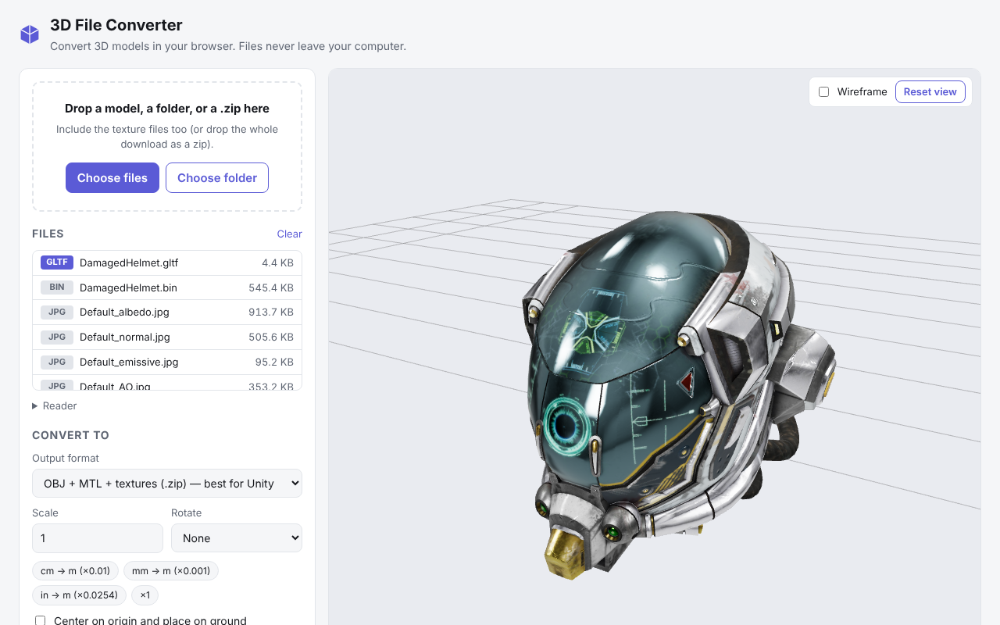
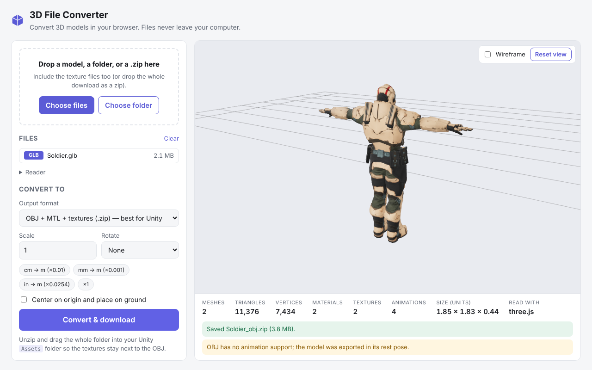
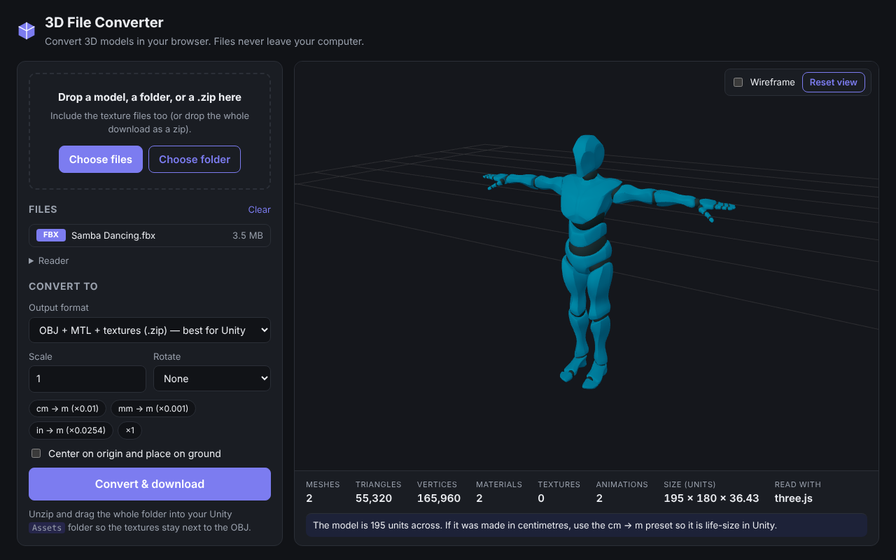
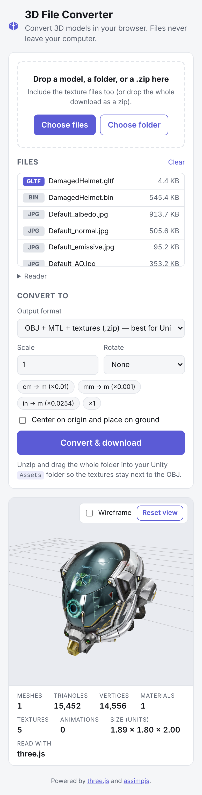

# 3D File Converter

Convert 3D models between formats entirely in your browser — nothing is uploaded anywhere.
Built mainly for turning free store downloads (FBX, GLB, BLEND, DAE, …) into **OBJ + MTL + textures** that drop straight into Unity.

**Live app:** https://teerasak-mairoddee.github.io/3d-file-converter/



## The story so far

Free 3D models from asset stores come in every format imaginable: FBX from one artist, GLB from another, a `.blend` file, a Collada export, an old 3DS model with its textures in a separate folder. Getting each of those into a Unity project meant a different tool, or a trip through Blender, every time.

So we built one page that takes all of them in and hands back the same thing every time.

- **It runs entirely in the browser.** Models are read and converted on your own machine with three.js and a WebAssembly build of Assimp, so there is no server, nothing is uploaded, and the site is just static files on GitHub Pages.
- **It reads 40+ formats.** Common ones use three.js loaders; the rest, and anything three.js chokes on, fall back to Assimp automatically.
- **It understands messy store downloads.** You can drop a whole zip or folder. Textures are matched by file name even when the model points at a path on the original artist's computer, and anything still missing is listed by name.
- **It writes a Unity-ready OBJ.** The export is a zip holding the `.obj`, a `.mtl` that points at the textures by relative path, and a `textures/` folder, so Unity picks up materials and textures on import. Textures are copied in their original format where Unity can read it, and re-encoded as PNG otherwise.
- **It fixes size and orientation on the way.** Scale presets (cm → m, mm → m, inches → m), a Z-up → Y-up rotation and "center and place on ground" bake the fix into the file, so it never has to be corrected in Unity.

We tested it on FBX, GLB, glTF, OBJ, DAE, 3DS, BLEND, X, STL and PLY samples, and loaded the OBJ zips it produced back into the app to confirm geometry and textures survive the trip.

## Unifying models for Unity

The goal is that every model in a project, wherever it came from, arrives in the same shape: **an OBJ in metres, Y-up, sitting on the ground at the origin, with its textures beside it.** Then every model drops into a scene the same way and nothing needs per-model fixing.

For each new model:

1. **Drop the store download as-is** onto the converter (zip, folder, or files). Don't unpack or rename things first.
2. **Check the preview and the stats bar.**
   - Fix the size: aim for real-world metres. If the app says the model is hundreds of units across, it was almost certainly built in centimetres, so click **cm → m**. A door should be about 2 units tall, a person about 1.8.
   - Fix the orientation: if it is lying on its back, choose **Z-up → Y-up**. If it faces away from you, choose **Turn 180°**.
   - Tick **Center on origin and place on ground** so its pivot is at its feet.
   - Read any warnings. A missing-texture warning names the files to add; drop them in and the preview updates.
3. **Export "OBJ + MTL + textures (.zip)"** and unzip it.
4. **Drag the whole unzipped folder** into the Unity project, for example under `Assets/Models/<ModelName>/`. Keep the `.obj`, `.mtl` and `textures/` together, or the materials lose their textures.
5. **In Unity**, leave the import Scale Factor at 1, since the size was already fixed in the converter. If the project uses URP or HDRP and the materials show up pink, convert them with Unity's render pipeline material converter.

When OBJ is the wrong choice: OBJ holds static meshes only, so animated or rigged characters are exported in their rest pose. For those, keep the original FBX for Unity, or export GLB from the converter if the project has a glTF importer. Everything static (props, buildings, vehicles, environment pieces) should go through the OBJ route above.

## Screenshots

| Converted to OBJ for Unity | Dark mode, with a scale hint for a centimetre-sized FBX |
| --- | --- |
|  |  |

<p align="center"></p>

## Using it

1. Drop the model onto the page. Include its textures: drop the whole folder, select all the files, or drop the store's `.zip` as-is.
2. Check the preview. Use **Scale** (e.g. *cm → m*) and **Rotate** (*Z-up → Y-up*) if the model is the wrong size or lying on its side.
3. Pick an output format and click **Convert & download**.
4. For Unity: unzip and drag the whole folder into `Assets/` so the `textures/` folder stays next to the `.obj`.

If textures are referenced but not supplied, the app lists the missing file names; the exported `.mtl` still references them, so you can add them to the `textures/` folder later.

## Formats

**Reads:** FBX, GLB, glTF (+ .bin + textures), OBJ (+ MTL), DAE (Collada), 3DS, BLEND, USDZ/USD, STL, PLY, 3MF, AMF, VRML, LWO, X, ASE, MS3D, B3D, MD2/MD3/MD5, SMD, OFF, AC3D, DXF, IFC, Ogre XML, KMZ, VOX, VTK, PCD, XYZ, and other formats supported by [Assimp](https://github.com/assimp/assimp).

**Writes:** OBJ + MTL + textures (zip), GLB, glTF, STL, PLY, USDZ.

Common formats are read with [three.js](https://threejs.org) loaders; everything else (and anything three.js fails on) goes through [assimpjs](https://github.com/kovacsv/assimpjs), a WebAssembly build of Assimp. You can force either engine under **Reader**.

OBJ notes: geometry is baked into world space in the model's rest pose (OBJ has no animation or skeletons), multi-material meshes are split per material, and textures keep their original files when possible (otherwise they are saved as PNG).

## Development

```sh
npm install
npm run dev      # local dev server
npm run build    # static build in dist/
```

Pushing to `main` builds the site and publishes `dist/` to the `gh-pages` branch via GitHub Actions.
